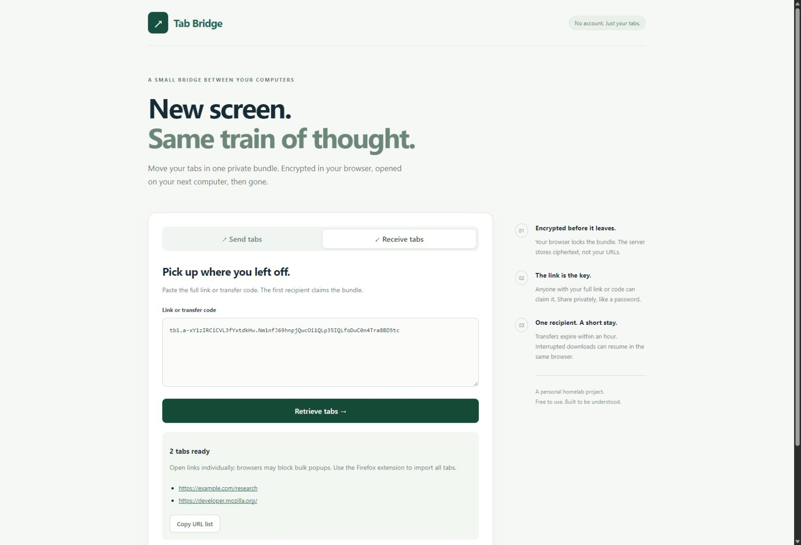
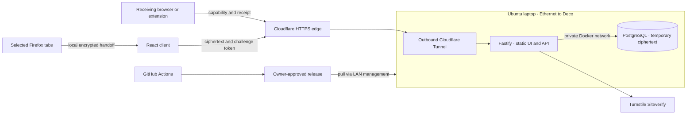

# Tab Bridge

### New screen. Same train of thought.

**An accountless, browser-encrypted tab transfer app for a small Linux homelab.**

Move a research session from a desktop to a laptop without signing in, synchronizing your browsing history, or putting private URLs on a public pasteboard. Select Firefox tabs or paste a URL list, create a short-lived encrypted bundle, and retrieve it on another computer using its link or code.

React · Vite · TypeScript · Fastify · PostgreSQL · Docker Compose · Cloudflare Tunnel



> **Possession is permission.** Anyone with the complete transfer link or code can claim the bundle. There is no recipient identity verification, account, password reset, or secret recovery. Share codes privately.

## Included

- React send/receive UI, clipboard links and manual codes; no accounts.
- AES-256-GCM encryption, 256-bit random secrets, independent HKDF-derived retrieval credentials, fragment links.
- Strict Fastify API, PostgreSQL storage and persistent quotas, bounded payloads, server-verified Turnstile uploads.
- Atomic single-recipient claims, same-receipt retries, acknowledgment-based ciphertext deletion, automatic expiry.
- Firefox multi-selection → right-click → encrypted website handoff for upload verification. Import codes in the extension to open tabs after review.
- Crypto, API, fault recovery and PostgreSQL transaction tests; GitHub Actions; container configuration and homelab runbook.

**Status:** implemented locally, not published or deployed. [Verification](docs/VERIFICATION.md) distinguishes executed checks from required Firefox, Turnstile and Linux deployment acceptance. Optional QR codes are deferred.

## Local demo

Install Node.js 24, then run from this directory:

```sh
npm ci
npm run build
npm test
npm run demo
```

Open **http://localhost:5173**. The demo binds only to loopback, uses temporary memory, and explicitly displays that public verification is disabled. Restarting loses server transfers. Never proxy or tunnel this demo to the internet.

Create a transfer and retrieve it in another browser/profile. Same-browser retries deliberately use its saved receipt and encrypted recovery copy. For hot reload, copy `.env.example` to `.env`, run `npm run dev:api` and `npm run dev` in separate terminals. The built demo avoids a Vite optimizer limitation observed in this Windows sandbox.

The web interface shows **Copy code** and **Copy secure link** only after the upload API confirms success. If upload confirmation is interrupted, the original encrypted draft remains in this tab for idempotent retry; an explicitly labeled recovery code is available after a failed attempt but is not proof that the transfer exists on the server. A successful confirmation remains visible after refreshing the same tab (subject to local session storage).

## Firefox

1. Build, then load **`extension-dist/manifest.json`** at `about:debugging#/runtime/this-firefox` → Load Temporary Add-on. Do not load the source manifest at the repository root.
2. Ctrl/Shift-select tabs, right-click a selected tab → **Tab Bridge: Send selected tabs**.
3. The extension writes an encrypted draft directly into the intended Tab Bridge tab through Firefox MAIN-world injection, and reloads that tab without putting URLs or secrets in the navigation URL. Complete verification, upload, then copy the link/code.
4. On the second computer, open the extension popup → **Encrypted transfer / receive code**. Retrieve, review, and open tabs.

The original local copy/import workflow remains. The extension contains no privileged server credential and uses the same API/protocol. Set `TAB_BRIDGE_ORIGIN` to your exact HTTPS origin before building the public extension. Bash: `TAB_BRIDGE_ORIGIN=https://tabs.example.com npm run build`. PowerShell: `$env:TAB_BRIDGE_ORIGIN='https://tabs.example.com'`, then `npm run build`. Default is `http://localhost:5173`; only the configured origin receives host permissions.

If sending fails, the extension opens a transfer page with the error (including a missing site-permission warning). The Firefox extension requires the `scripting` permission and Tab Bridge host access. Temporary add-ons disappear after restart. Regular Firefox distribution requires Mozilla signing, a stable add-on ID, and accurate privacy/data-collection disclosures. The supplied ID is a placeholder; signing and live Firefox testing are operator steps.

## Architecture



No router port forwarding, public SSH, public PostgreSQL or Docker API. The tunnel reaches only the app. Netlify can later link to the standalone app from the personal portfolio; it performs no transfer processing/storage.

## Transfer lifecycle

```mermaid
stateDiagram-v2
  [*] --> Prepared: Client encrypts and saves retry draft
  Prepared --> Available: Verified upload commits
  Available --> Claimed: Atomic claim with receipt hash
  Claimed --> Claimed: Same receipt retries
  Claimed --> Acknowledged: Client saves ciphertext and decrypts, then ACK
  Acknowledged --> [*]: Ciphertext removed; tombstone expires
  Available --> Expired: TTL reached
  Claimed --> Expired: TTL reached
  Expired --> [*]: Cleanup
```



Deleting at the start of a download loses transfers when responses are interrupted. Instead, a transaction assigns one claimant. The receiver saves a random receipt before requesting data and ciphertext before acknowledging. No other claimant can take over. Claims never reset to available; expiry still applies.

## Engineering decisions

| Decision | Why; tradeoff |
| --- | --- |
| Browser encryption and fragment | Server storage needs no plaintext/key; delivered JavaScript is still trusted. |
| Independent retrieval capability | A server-visible credential cannot derive the decryption key. |
| PostgreSQL locks/transactions | Concurrent recipients cannot both win; same-receipt retry is intentional. |
| Claim → save → acknowledge | Network failures do not immediately destroy the only copy; physical exactly-once delivery/opening is impossible. |
| PostgreSQL quotas, no Redis | One durable database; suitable for modest homelab scale. |
| Single frontend/API origin | Fewer CORS/reverse-proxy complications. |
| Web challenge for extension uploads | No privileged extension keys or challenge bypass. |
| Owner-approved pull deployment | CI needs neither public SSH nor a privileged home-network runner. |

## Project map

```text
src/          React UI and styles
shared/       Crypto, URL validation, recovery client
server/       Fastify, PostgreSQL, schema, Turnstile
extension/    Firefox handoff and encrypted receiver
tests/        Protocol, API, failure recovery, database races
scripts/      Builds and local demo
docs/         Requirements, security, deployment, verification
.github/      CI and dependency updates
compose.yaml  Private services; tunnel profile is opt-in
```

- [Final specification and testable milestones](docs/SPECIFICATION.md)
- [Protocol and threat model](docs/SECURITY.md)
- [Ubuntu deployment, maintenance and recovery](docs/DEPLOYMENT.md)
- [Verification record](docs/VERIFICATION.md)

The old laptop, home power, ISP, and Cloudflare are availability dependencies. Encryption does not promise anonymity, protect compromised endpoints, prevent recipients copying URLs, or immediately erase old ciphertext from physical storage/WAL/backups.
